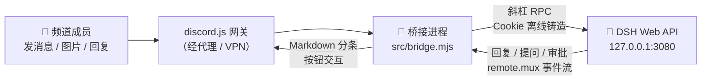

<div align="center">


# dsh-discord-plugin

**让 DSH agent 住进你的 Discord 服务器**

频道里发消息它就聊 · 图片能看懂 · 提问出按钮 · 审批点点点


</div>

> **一句话**：这是 DeepSeek Harness（DSH）与 Discord 之间的桥——你在 Discord 说话，本地 DSH agent 干活，回复、追问、工具审批全部以 Discord 原生交互回流。协议层对齐 [Derpyu520/qq-bridge](https://github.com/Derpyu520/qq-bridge)，Discord 侧全新实现。

---

## 📐 架构



## ✨ 功能特性

| | 特性 | 说明 |
|---|---|---|
| 💬 | **每频道独立会话** | key 为 `guild:<guildId>:<channelId>` / `dm:<userId>`，映射持久化到 `state/sessions.json`，归组「Discord 聊天」工作区 |
| 🔐 | **离线鉴权** | 读 `~/.dsh/.credentials.yaml` 签名密钥本地铸造 Cookie，DSH 重启免重配；也可显式 `dsh.authToken` |
| 🖼️ | **多模态** | 图片附件直接喂模型（单张 8MB / 单条 5 张），非图片附件只标注文件名 |
| ↩️ | **引用注入** | Discord 回复消息 → `[引用 昵称：原文]` 进入上下文 |
| 🏷️ | **提及归一化** | `<@id>` / `<#id>` / 自定义表情 → `@昵称` / `#频道名` / `:表情:` |
| ❓ | **提问转按钮** | `ask_user_question` → 频道内按钮作答，5 分钟超时自动回空 |
| 🔐 | **审批转按钮** | 工具审批 → 「允许 / 拒绝」按钮，超时自动拒绝 |
| 🛡️ | **fail-closed 安全** | 白名单为空不响应；黑名单优先；preset 缺失**拒绝建会话**（绝不回退到带本地工具的默认 preset） |
| 📥 | **掉线补投** | DSH 不可用时消息内存排队（每会话 50 条），恢复自动补投，5 秒探活 |
| ⌨️ | **斜杠命令** | `/ds-reset` 重置会话 · `/ds-status` 查看状态 |
| 📄 | **Markdown 直通** | 回复 2000 字符智能分条，代码块 fence 自动配平 |

<details>
<summary><b>🛡️ fail-closed 三道闸（安全设计细节）</b></summary>

1. **白名单闸**：`allow` 为空且 `allowAllWhenEmpty=false` 时，任何消息都不响应
2. **黑名单闸**：`deny` 永远优先于 `allow`
3. **preset 闸**：配置的 `agentPreset` 在 DSH 中不存在时直接拒绝建会话——绝不回退到 DSH 默认 preset（否则 bash / 文件读写等本地工具会暴露给频道里的任何人）

> 结果：频道成员**物理上无法**借 agent 操作你的电脑——不是靠提示词约束，而是工具根本不存在。

</details>

## 🖥️ 可视化控制台

桥接进程内置 SnowLuma 风格的本地 WebUI（React 19 + react-router 构建），启动后监听 **`http://127.0.0.1:8310`**（端口可改 `consolePort`）：

| 页签 | 功能 |
|---|---|
| **仪表盘** | Discord/DSH 在线状态、活跃会话数、排队数、已接入服务器 |
| **白名单** | 服务器/频道/用户三级白黑名单可视化增删，保存即**热生效**（无需重启桥接） |
| **会话** | 所有活跃会话列表（回合中/空闲/排队数），一键重置 |
| **人格** | 可视化编辑 persona 前缀，保存自动重渲染 DSH bundle（重启 DSH 后生效） |
| **日志** | 桥接日志实时滚动（最近 500 条），支持暂停/清屏 |

- **访问方式**：桥接启动日志会打印带完整令牌的一键链接，复制到浏览器打开一次即自动记住
- **安全**：只监听 `127.0.0.1`，API 需要 `consoleToken`（首次启动自动生成写入 config.json）
- 端口被占用时自动 +1 顺延（3101、3102…），不影响桥接收发消息
- 前端源码在 `console-ui/`（Vite + React 19 + react-router），构建产物 `web/` 随仓库提交；改前端后跑 `npm run build:console`

## 📁 目录结构

```
📦 dsh-discord-plugin
├── 📂 src/
│   ├── bridge.mjs           # 主程序：配置 / 状态 / 白名单 / 会话管理 / 事件泵 / 斜杠命令
│   ├── dsh-client.mjs       # 自包含 DSH 客户端（Cookie 铸造 + 斜杠 RPC + remote.mux + turn collector）
│   ├── discord-format.mjs   # 2000 字符分块（fence 配平）、提及/表情归一化
│   ├── proxy-bootstrap.mjs  # 代理引导：REST(undici) + 网关 WebSocket(ws)，127.0.0.1 直连
│   ├── console.mjs          # 本地控制台：HTTP 服务器 + REST API + 静态托管 web/
│   └── preset-build.mjs     # preset 源 → DSH bundle patch 渲染（setup 与控制台共用）
├── 📂 console-ui/           # 控制台前端源码（Vite + React）
├── 📂 web/                  # 控制台构建产物（随仓库提交，clone 即用）
├── 📂 dsh/agent-presets/discord-chat/   # 最小权限 preset 源文件（无任何本地工具）
├── 📂 scripts/
│   ├── setup-dsh.mjs        # 从源渲染 patch，以 bundle 机制注册进 DSH profile（幂等）
│   ├── build-exe.mjs        # SEA 单文件 exe 打包（npm run build:exe）
│   ├── self-test.mjs        # 离线自测（10 例，不需要 Discord/DSH）
│   └── test-console-api.mjs # 控制台 API 端到端回归（15 例）
└── 📂 state/                # 运行时数据（不入库）：sessions.json + 会话工作目录
```

## ⚡ 一键启动 exe

不想装 Node / 不想敲命令？把整个项目打包成单个 exe：

```bash
npm run build:exe
```

产物 `dist/`：

```
dist/
├── dsh-discord.exe    # 双击启动（88MB，内嵌 Node 22 运行时）
├── config.json        # 首次自动生成，填 discord.token
├── web/               # 控制台前端
└── dsh/               # preset 源（控制台里改人格改的就是它）
```

- 双击 `dsh-discord.exe` → 桥接启动 → **自动弹出控制台浏览器页面**
- `config.json` / `state/` / `dsh/` 都在 exe 旁边，换电脑拷整个 `dist/` 文件夹即可
- 基于.Node 官方 SEA（Single Executable Application）方案，无第三方打包器

## 🚀 部署

### ① 创建 Discord Bot

到 [Discord Developer Portal](https://discord.com/developers/applications)：

1. 新建 Application → **Bot** → **Reset Token**，复制 Token（只显示一次）
2. 同页打开 **MESSAGE CONTENT INTENT**（必开，否则收不到消息内容）
3. **OAuth2 → URL Generator**：scopes 勾 `bot` + `applications.commands`，权限给「发送消息 / 读取消息 / 添加回应」，用链接邀请进服务器

> [!NOTE]
> 需要的是 **Bot Token**，不是 App ID 或 Public Key——公钥只在 webhook 模式才用，本项目走 WebSocket 网关。

### ② 准备 DSH

```bash
npm install
npm run setup-dsh    # discord-chat preset 以 bundle 机制装进 DSH profile
```

> [!WARNING]
> 必须**重启 DSH** 使 preset 生效——否则会因 fail-closed 拒绝建会话（频道里毫无反应）。

> [!TIP]
> 机制说明：DSH 0.1.7 起 `~/.dsh/.agent-presets/` 已废弃。preset 由 profile 里 bundle 的 patch 文件插入（`@deepseek-ai/dsh-agent-preset` 行）。源文件在 `dsh/agent-presets/discord-chat/`（改人格/工具面只改那里），安装时自动渲染注册。

### ③ 配置

```bash
cp config.example.json config.json
```

必改：`discord.token` 填 Token；`allow` 白名单至少填一项（开发者模式下右键服务器/频道 → 复制 ID）。

### ④ 网络（国内环境）

Node 不认系统代理，本插件内置双通道代理处理：

| 通道 | 方案 |
|---|---|
| REST（discord.com API） | undici 全局 dispatcher |
| 网关 WebSocket（gateway.discord.gg） | `https.globalAgent` 替换为代理 agent |
| DSH（127.0.0.1） | **永远直连**，不受代理影响 |
| TLS 证书 | 启动脚本带 `--use-system-ca`，信任 Windows 证书库（TUN 模式 VPN 也能过） |

`discord.proxy` 取值：

| 值 | 行为 |
|---|---|
| `"auto"`（默认） | `HTTPS_PROXY` 环境变量 → Windows 系统代理（注册表）→ 直连 |
| `"env"` | 只认环境变量 |
| 显式地址 | 如 `"http://127.0.0.1:7890"`（Clash 默认 7890，v2rayN 默认 10808/10809） |
| `""` | 强制直连 |

### ⑤ 启动

```bash
npm start
```

成功标志：

```log
[proxy] 已启用代理: http://...   （或「直连」——TUN 模式 VPN 下直连也能通）
正在连接 Discord 网关…
Discord 已连接：你的Bot名#xxxx
连接 DSH 事件流…
✅ DSH 恢复可用
```

然后到白名单频道发条消息测通。`npm run self-test` 随时跑离线回归。

<details>
<summary><b>⚙️ 完整配置项</b></summary>

#### discord（Discord 侧）

| 字段 | 说明 |
|---|---|
| `token` | Bot Token（必填） |
| `ackReaction` | 收到消息时的表情回应（如 `"🫡"`），留空关闭 |
| `proxy` | 代理，见上表；默认 `"auto"` |

#### dsh（DSH 侧）

| 字段 | 说明 |
|---|---|
| `baseUrl` | DSH 地址，默认 `http://127.0.0.1:3080` |
| `provider` / `model` / `reasoningEffort` | 会话模型，默认 `deepseek-official` / `deepseek-flash` / `max` |
| `authToken` | 通常留空（走离线铸造）；显式填写则尊重该意图 |
| `allowRemote` | 连远程 DSH 且需用 launch token 时才允许 `true` |

#### 行为

| 字段 | 说明 |
|---|---|
| `agentPreset` | 默认 `discord-chat`；设为空串则用 DSH 默认 preset（**不建议**，本地工具会暴露） |
| `workspaceTitle` | DSH 工作区标题，默认「Discord 聊天」 |
| `sessionCwd` | DSH 会话工作目录，默认 `state/agents` |
| `allow.guilds/channels/users` | 白名单（任一命中即放行） |
| `deny.guilds/channels/users` | 黑名单，永远优先于白名单 |
| `allowAllWhenEmpty` | `true` 时白名单为空也响应所有消息（默认 `false`） |
| `maxQueuePerSession` | DSH 掉线时每会话内存排队上限，默认 50 |
| `questionTimeoutMs` | 提问/审批按钮超时，默认 5 分钟 |
| `maxMediaBytes` / `maxMediaCount` | 图片单张 8MB / 单条 5 张 |
| `pollIntervalMs` | DSH 掉线后的探活间隔，默认 5 秒 |

</details>

## 🔧 故障排查

<details open>
<summary><b>实战踩坑记录（点开查表）</b></summary>

| 现象 | 原因 | 处理 |
|---|---|---|
| 卡在「正在连接 Discord 网关…」 | 无可用代理路径，直连被墙 | 浏览器能否打开 discord.com？不能 → 修 VPN；能 → 填 `discord.proxy` |
| `unable to verify the first certificate` | VPN TUN 模式 TLS 拦截，Node 不认 Windows 证书库 | 已由 `--use-system-ca` 解决；确认用 `npm start`（别直接 `node src/bridge.mjs`） |
| 网关报 `Unexpected server response: 502` | 流量被 VPN 接管但上游节点不通 | VPN 没真正连上：换节点/重连，浏览器验证 |
| Discord 在线但频道发消息无反应 | ① 不在白名单；② preset 未生效 | ① 查 `allow`；② `npm run setup-dsh` + 重启 DSH，看日志是否报「agentPreset 不在 DSH 可用清单」 |
| `fetch failed` / `⚠️ DSH 不可用` | DSH 没在运行 | 启动 DSH，确认浏览器能打开 `127.0.0.1:3080`；桥接会自动探活补投，无需重启 |
| 回复被分条 | 单条消息上限 2000 字符 | 正常行为，代码块自动补齐 fence |
| 想重置某频道上下文 | — | 频道里输入 `/ds-reset` |

</details>

## 🔀 与 qq-bridge 的差异

- Discord 侧基于官方 Bot API（discord.js v14），无 QQ 生态的风控/语音/表情库复杂度
- 不含社交仿真、黑话学习、Web 控制台、token 计费看板——需要时可从 qq-bridge 移植
- 回复 Markdown 直通（QQ 需转纯文本）；提问/审批用原生按钮而非文本解析
- DSH 客户端不依赖 `@deepseek-ai/dsh-host-apiproxy`，基类手搓，运行依赖仅 4 个 npm 包
- 内置国内网络代理方案（REST + WebSocket 双通道，系统代理自动检测）

## 🧬 已知协议细节（给后来维护者）

> 以下均为 qq-bridge / 本项目对 DSH 0.2.1 逐项实测的结论：

- DSH 0.2.1 的事件流**可能不发 `turn/start`**：事件直接从 `step/start` → `assistant/message` → `turn/end`。turn collector 必须按 `assistant/message` 惰性建档，否则所有回复被静默丢弃
- `session/follow` 的开场快照（`session/snapshot`）含历史 `turn/end`，绝不能混进 `session/event` 通道——否则旧回合会被当成新回复发出
- 断线重连必须重放全部期望 follow 的会话，否则已存在会话会静默失联
- `assistant/chunk` 是流式分块，与 `assistant/message` 内容重复，累加会导致回复翻倍

---

<div align="center">

**MIT License** · 架构参考 [Derpyu520/qq-bridge](https://github.com/Derpyu520/qq-bridge) 💙

</div>
